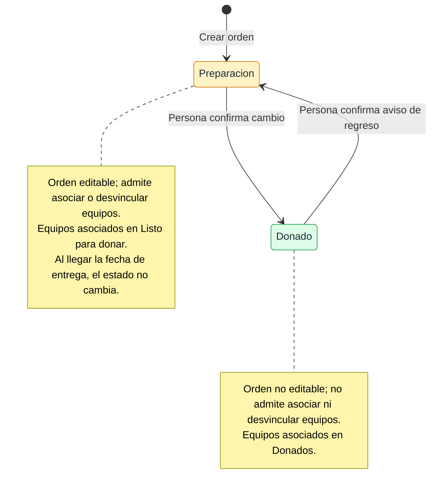
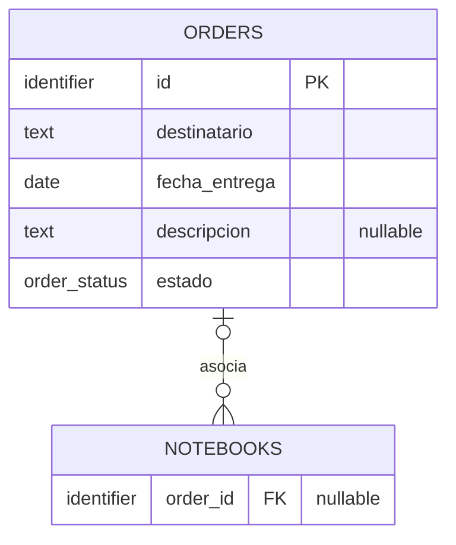

# Órdenes — diseño del sistema

## Árbol

```text
Diseño del sistema
├─ 1 Datos de las órdenes y relación con los equipos — resuelta
├─ 2 Circulación de datos entre Órdenes e Inventario — resuelta
│  ├─ 2.1 Crear una orden — resuelta
│  │  ✓ El formulario bloquea el envío si falta destinatario o fecha; si falla el guardado,
│  │    no se crea la orden y la persona vuelve a intentar el envío.
│  ├─ 2.2 Editar una orden — resuelta
│  │  ✓ El botón Editar habilita modificar los campos y los equipos asociados en En Preparación.
│  │  ✓ Guardar Cambios aplica todos esos cambios en una única transacción.
│  │  ✓ Si la transacción falla, nada cambia en la base; se notifica el error y se conservan los cambios en el formulario.
│  │  ✓ El formulario bloquea el guardado si falta destinatario o fecha.
│  ├─ 2.3 Asociar un equipo — resuelta
│  │  ✓ El selector múltiple permite elegir equipos Listos para donar durante la edición.
│  │  ✓ La asociación queda pendiente hasta Guardar Cambios y se persiste junto con el resto.
│  ├─ 2.4 Desvincular un equipo — resuelta
│  │  ✓ El modal permite elegir el estado de retorno; la desvinculación queda pendiente hasta Guardar Cambios.
│  │  ✓ El vínculo se limpia al guardar y no se conserva historial.
│  ├─ 2.5a Cambiar a Donado — resuelta
│  │  ✓ En Preparación → Donado cambia los equipos a Donados.
│  ├─ 2.5b Volver a En Preparación — resuelta
│  │  ✓ Al confirmar, cambia orden y equipos a En Preparación/Listo para donar en una transacción.
│  └─ 2.6 Eliminar una orden vacía — resuelta
│     ✓ Solo se elimina si no tiene equipos asociados y no está Donado.
│  ✓ Q3 El formulario bloquea la edición si falta destinatario o fecha.
│  ✓ Q4 (actualizada) Campos, asociaciones y desvinculaciones se guardan juntos al pulsar Guardar Cambios.
│  ✓ Q5 Si falla esa transacción, no se persiste ningún cambio; se notifica y se conservan las modificaciones en el formulario para reintentar.
│  ✓ Q6 No se elimina una orden Donado, aunque esté vacía.
│  ✓ Q7 La edición compuesta es atómica; el cambio de estado de una orden y sus equipos también es atómico.
│  ✓ Q8 La transacción incluye el estado de la orden y todos sus equipos; si falla, nada cambia y se reintenta.
├─ 3 Ciclo de estados y reglas de consistencia — resuelta
│  ✓ Una orden nueva entra en En Preparación.
│  ✓ Al pasar a Donado, todos los equipos pasan a Donados en la misma transacción.
│  ✓ Al volver a En Preparación, los equipos pasan a Listo para donar en esa transacción.
│  ✓ El regreso requiere confirmar el modal; cerrarlo cancela la acción.
│  ✓ Donado no es terminal: se puede volver a En Preparación.
│  ✓ En Donado no se editan los datos ni se agregan o quitan equipos.
│  ✓ Los equipos asociados muestran su estado propio y la orden con su fecha de entrega en Inventario.
│  ✓ Q9 Llegar a la fecha de entrega no cambia el estado de la orden.
└─ 4 Interacción de las personas con Órdenes e Inventario — resuelta
   ✓ La entrada a Órdenes es una tabla con destinatario, fecha y estado; permite buscar por destinatario o número de serie y filtrar fechas.
   ✓ El detalle de una orden muestra campos editables y equipos con nombre, número de serie, estado y especificaciones.
   ✓ Si está En Preparación, el detalle ofrece Guardar Cambios; en Donado no permite editar.
   ✓ Agregar equipo abre un modal con selector múltiple y búsqueda por número de serie, modelo y nombre.
   ✓ Al desvincular, se elige el estado con el que el equipo vuelve al Inventario.
   ✓ Se puede cambiar la orden entre En Preparación y Donado; el regreso muestra un aviso confirmable.
   ✓ Se elimina una orden solo si está vacía y no está Donado.
   ✓ En el formulario del equipo, sobre modelo y marca, se muestran destinatario y fecha; destinatario enlaza al detalle de la orden.
   ✓ Se incluyen estados sin órdenes, orden sin equipos, sin equipos disponibles, carga y error.
   ✓ Q10–Q14 Se asentaron la tabla, el detalle, el selector múltiple, el vínculo desde Inventario y los estados de pantalla.
   ✓ Q15 La búsqueda por número de serie muestra la orden que tiene asociado el equipo coincidente.
   ✓ Q16 Los cambios de campos, equipos agregados y equipos quitados se aplican juntos al guardar la edición.
   ✓ Q17 La tabla sin coincidencias muestra «No se encontraron resultados»; el detalle sin equipos muestra «Aún no hay equipos asociados, edite la orden para vincularlos»; el selector sin equipos disponibles muestra ese mensaje.
   ✓ Q18 Si falla una lectura (por ejemplo, 404), se informa un error de consulta.
   ✓ Q19 El filtro de fechas incluye ambos extremos.
   ✓ Q20 Si todavía no hay órdenes, la tabla muestra «No hay órdenes disponibles».
   ✓ Q21 Durante la carga se muestra un indicador consistente con la página, como un spinner o «Cargando».
   ✓ Q22 Con cambios pendientes, el modal permite quedarse editando o salir descartándolos sin guardar.
   ✓ Se eligió la composición A: campos de la orden antes de la lista de equipos, que usa todo el ancho disponible.
   ✓ Se aprobó la alternativa A adaptada a los estilos existentes de la aplicación.
```

## 3. Ciclo de estados y reglas de consistencia

Una orden recorre los estados En Preparación y Donado. La persona inicia ambas transiciones; el regreso a En Preparación requiere confirmar un aviso. El cambio de estado de la orden y de todos sus equipos asociados se aplica atómicamente. Los estados de equipo afectados son Donado y Listo para donar, respectivamente.

Mientras la orden está Donado, sus datos no se editan y sus equipos no se pueden asociar ni desvincular. En Inventario, un equipo asociado presenta su estado y permite ver la orden asociada y su fecha de entrega.



El diagrama muestra el ciclo de la orden y resume en cada estado las restricciones y el estado de sus equipos asociados. La transición de regreso requiere confirmar el aviso; cerrarlo cancela la acción. Ambas transiciones actualizan la orden y todos sus equipos atómicamente, como se definió en la rama 2. La fecha de entrega no provoca una transición de estado.

### Decisiones asentadas

- Una orden nueva entra en En Preparación.
- Donado no es un estado terminal: la orden puede volver a En Preparación.
- Cerrar el aviso de regreso cancela la transición; confirmar la ejecuta y habilita de nuevo la edición.
- La transición actualiza el estado de la orden y el de todos sus equipos en una sola transacción. Si falla, no cambia ninguno y se puede reintentar.
- Llegar a la fecha de entrega no cambia el estado de la orden.
- Las restricciones de edición y asociación/desvinculación en Donado se definen en la rama 2; esta rama describe cómo dependen del estado.

### Fuera de esta rama

La presentación y ubicación visual de estos estados en las pantallas se define en la rama 4.

## 4. Interacción de las personas con Órdenes e Inventario

La sección Órdenes permite crear y gestionar órdenes y los equipos asociados, sujeto a las reglas de estado asentadas en las ramas 2 y 3. Desde el detalle de un equipo en Inventario, se indica si pertenece a una orden y se puede abrir esa orden.

### Decisiones asentadas

- La entrada a Órdenes es una tabla; cada fila muestra destinatario, fecha de entrega y estado.
- La tabla permite buscar por destinatario o número de serie y filtrar por rango de fechas, inclusive.
- Buscar por número de serie muestra la orden que tiene asociado el equipo coincidente.
- Al abrir una orden se muestra una página de detalle en modo consulta con sus campos y su lista de equipos asociados.
- Cada equipo asociado muestra nombre, número de serie, estado y especificaciones.
- El botón Editar habilita cambiar campos, agregar equipos y quitar equipos; Guardar Cambios aplica todo en una transacción.
- Agregar equipo abre un modal con un selector múltiple que busca por número de serie, modelo y nombre. Los cambios seleccionados quedan pendientes hasta guardar la edición.
- Al quitar un equipo se elige el estado de retorno; el cambio también queda pendiente hasta guardar.
- Si falla la transacción, nada cambia en la base, se notifica el fallo y se conservan los cambios en el formulario para reintentar.
- En el formulario de equipo, encima de modelo y marca, se muestra el destinatario y la fecha de entrega; el destinatario es un enlace al detalle de la orden.
- La tabla sin coincidencias muestra «No se encontraron resultados».
- Si todavía no hay órdenes, la tabla muestra «No hay órdenes disponibles».
- El detalle sin equipos muestra «Aún no hay equipos asociados, edite la orden para vincularlos»; el selector sin equipos disponibles muestra ese mismo mensaje.
- Si falla una lectura, por ejemplo con un 404, se informa un error de consulta.
- Durante la carga se muestra un indicador coherente con el estilo de la página, como un spinner o el texto «Cargando».
- Si se intenta cancelar la edición o salir del detalle con cambios pendientes, un modal permite quedarse editando o salir descartando los cambios sin guardarlos.
- La gestión de estados y eliminación respeta las reglas asentadas en las ramas 2 y 3.
- Se eligió la composición A para el detalle: campos de la orden arriba y lista de equipos debajo, a todo el ancho.
- Se aprobó el prototipo de la alternativa A adaptado a la tipografía, colores, controles, navegación y tabla de la aplicación.

## 1. Datos de las órdenes y relación con los equipos

Una orden representa una donación y guarda un destinatario obligatorio, que también sirve de título, una fecha de entrega obligatoria con precisión de día, una descripción opcional y su propio estado. Una orden nueva empieza en En Preparación y los estados definidos son En Preparación y Donado. Puede existir sin equipos asociados.

La entidad existente `notebooks` representa los equipos. Un equipo puede no tener orden o estar asociado a una única orden actual; una orden puede tener varios equipos. La asociación no conserva historial cuando se quita el vínculo.



`ORDERS` es una entidad nueva. `NOTEBOOKS` ya existe y recibe el campo nullable `order_id`; vacío significa que el equipo no está asociado a una orden. La relación permite varios equipos por orden y como máximo una orden actual por equipo. `descripcion` puede quedar vacía; `destinatario` y `fecha_entrega` no. La fecha representa un día, sin hora. `estado` pertenece a la orden y contiene En Preparación o Donado.

### Decisiones asentadas

- La orden guarda su propio estado.
- La fecha de entrega sustituye el concepto anterior de deadline y guarda día, mes y año.
- Los vínculos de órdenes anteriores no se conservan tras desvincular un equipo.
- La propuesta anterior de una tabla de asociación con `notebook_id` como PK queda reemplazada por el `order_id` nullable en `notebooks`.
- El campo `descripcion` es opcional; el destinatario y la fecha son obligatorios.

### Fuera de esta rama

La elección de tipos SQL concretos para identificadores y de constraints/migraciones pertenece a `$program-design`.

## 2.1. Crear una orden

Quien crea una orden aporta el destinatario, la fecha de entrega y, si quiere, una descripción. Si falta el destinatario o la fecha, el formulario no permite enviarla. Cuando se guarda, la orden empieza En Preparación y puede no tener equipos asociados.

```mermaid
sequenceDiagram
    autonumber
    actor U as Persona
    participant O as Órdenes
    database DB as Datos de órdenes
    U->>O: Ingresa destinatario, fecha y descripción opcional
    alt Falta destinatario o fecha
        O-->>U: Formulario bloquea el envío
    else Datos obligatorios presentes
        U->>O: Envía formulario
        O->>DB: Crear orden En Preparación sin equipos
        alt Guardado correcto
            DB-->>O: Orden guardada con id
        else Falla el guardado
            DB-->>O: Fallo; no se crea la orden
            O-->>U: Toast de fallo; conserva los valores ingresados
            U->>O: Reintenta el envío
        end
    end
```

El paso 1 recoge los datos. Si falta el destinatario o la fecha, el paso 2 bloquea el envío y no se escribe una orden. Con ambos presentes, los pasos 3 y 4 envían y guardan la orden en En Preparación, sin equipos asociados; el paso 5 devuelve el registro guardado. Si el guardado falla en el paso 6, no se crea la orden; el paso 7 muestra un toast y conserva lo ingresado para que la persona pueda repetir el envío en el paso 8. El diagrama no fija el mensaje de éxito ni la pantalla que se abre después del guardado, que pertenecen a la rama de interacción.

## 2.2. Editar una orden

Mientras la orden está En Preparación, Editar habilita cambiar destinatario, fecha de entrega, descripción y equipos asociados. Agregar y quitar equipos se prepara junto con los cambios de campos; Guardar Cambios persiste todo en una transacción. Si falta destinatario o fecha, el formulario bloquea el guardado. Si falla la transacción, no se persiste ninguno de los cambios, se notifica el fallo y se conservan las modificaciones en el formulario para reintentar.

```mermaid
sequenceDiagram
    autonumber
    actor U as Persona
    participant O as Órdenes
    database DB as Datos de órdenes
    U->>O: Pulsa Editar y modifica campos y equipos asociados
    alt Falta destinatario o fecha
        O-->>U: Guardado bloqueado
    else Campos obligatorios presentes
        U->>O: Pulsa Guardar Cambios
        O->>DB: Transacción: actualizar campos, asociaciones y desvinculaciones
        alt Guardado correcto
            DB-->>O: Orden y equipos actualizados
        else Falla el guardado
            DB-->>O: No se persiste ningún cambio
            O-->>U: Notifica el fallo; conserva los cambios en el formulario
            U->>O: Reintenta Guardar Cambios
        end
    end
```

En el paso 1 se entra en edición y se preparan cambios de campos y equipos sin modificar todavía los datos guardados. Si falta destinatario o fecha, el paso 2 bloquea el envío. Con los campos requeridos completos, los pasos 3 y 4 guardan todos los cambios en una sola transacción. Si falla en el paso 6, nada se modifica en la base; los pasos 7 y 8 informan el fallo y permiten reintentar conservando el formulario.

## 2.3. Asociar un equipo

Durante la edición, la persona puede abrir el selector múltiple de equipos Listos para donar y preparar asociaciones a la orden. Las selecciones no se persisten hasta Guardar Cambios; se guardan en la misma transacción que los campos y las desvinculaciones.

```mermaid
sequenceDiagram
    autonumber
    actor U as Persona
    participant O as Órdenes
    database DB as Datos de órdenes y equipos
    U->>O: Abre la lista de equipos para asociar
    O->>DB: Leer equipos Listos para donar
    DB-->>O: Equipos disponibles
    O-->>U: Mostrar equipos disponibles
    U->>O: Selecciona varios equipos
    O-->>U: Cambios quedan pendientes en el formulario
    U->>O: Pulsa Guardar Cambios
    O->>DB: Transacción de edición guarda los vínculos
    alt Guardado correcto
        DB-->>O: Vínculos creados junto con el resto de cambios
    else Falla la transacción
        DB-->>O: Sin cambios persistidos
        O-->>U: Notifica el fallo; conserva la selección
        U->>O: Reintenta Guardar Cambios
    end
```

Los pasos 1 a 4 muestran los equipos que cumplen la condición de asociación. El paso 5 prepara una o más asociaciones sin persistirlas. Los pasos 6 y 7 guardan esos vínculos junto con la edición completa. Si falla la transacción, ningún cambio se persiste; se notifica el fallo y se conserva la selección para reintentar. La manera de implementar y actualizar esa lista se define en `$program-design`.

## 2.4. Desvincular un equipo

Durante la edición, la persona elige desvincular un equipo y selecciona en el modal el estado con el que vuelve al Inventario. La desvinculación queda pendiente; Guardar Cambios limpia `notebooks.order_id` y actualiza el estado elegido junto con los demás cambios de la orden. No se conserva historial. Si falla la transacción, no hay cambios persistidos y se puede reintentar.

```mermaid
sequenceDiagram
    autonumber
    actor U as Persona
    participant O as Órdenes
    database DB as Datos de órdenes y equipos
    U->>O: En modo edición solicita quitar un equipo
    O-->>U: Mostrar estados disponibles
    U->>O: Elige estado de retorno y confirma la selección
    O-->>U: Cambio queda pendiente en el formulario
    U->>O: Pulsa Guardar Cambios
    O->>DB: Transacción guarda desvinculación y demás cambios
    alt Guardado correcto
        DB-->>O: Orden y equipo actualizados
    else Falla el guardado
        DB-->>O: Ningún cambio persistido
        O-->>U: Notifica el fallo; conserva los cambios en el formulario
        U->>O: Reintenta Guardar Cambios
    end
```

En los pasos 1 a 4 se prepara la desvinculación y se elige el estado de retorno, sin persistirla todavía. Los pasos 5 y 6 guardan la desvinculación en la transacción de edición. Si falla, el paso 7 deja los datos guardados como estaban; el paso 8 notifica y el paso 9 permite reintentar. No se puede desvincular desde una orden Donado.

## 2.5a. Cambiar una orden a Donado

Al cambiar una orden de En Preparación a Donado, el estado de la orden y el de todos sus equipos asociados se actualizan en una misma transacción. Si falla, no se persiste ningún cambio, se muestra un toast y se puede reintentar.

```mermaid
sequenceDiagram
    autonumber
    actor U as Persona
    participant O as Órdenes
    database DB as Datos de órdenes y equipos
    U->>O: Cambia estado a Donado
    O->>DB: Transacción: orden y equipos a Donado
    alt Transacción correcta
        DB-->>O: Estados actualizados
    else Falla la transacción
        DB-->>O: No se persiste ningún cambio
        O-->>U: Toast
        U->>O: Reintenta el cambio
    end
```

El paso 1 inicia la transición. En el paso 2 se actualizan juntos el estado de la orden y el de todos sus equipos asociados. El paso 3 confirma el resultado. Si la transacción falla en el paso 4, ninguno de los estados cambia; los pasos 5 y 6 notifican el fallo y permiten reintentar.

## 2.5b. Volver a En Preparación

Para volver de Donado a En Preparación, la persona confirma el modal de aviso. Al confirmar, el estado de la orden pasa a En Preparación y todos sus equipos pasan a Listo para donar en una misma transacción. Cerrar el modal no cambia nada. Si falla la transacción, nada cambia y la persona puede reintentar.

```mermaid
sequenceDiagram
    autonumber
    actor U as Persona
    participant O as Órdenes
    database DB as Datos de órdenes y equipos
    U->>O: Solicita volver a En Preparación
    O-->>U: Aviso sobre el cambio de estado de los equipos
    alt Cierra el modal
        U->>O: Cierra el aviso
        O-->>U: Sin cambios
    else Confirma el cambio
        U->>O: Elige Cambiar o Confirmar
        O->>DB: Transacción: orden a En Preparación; equipos a Listo para donar
        alt Transacción correcta
            DB-->>O: Estados actualizados
        else Falla la transacción
            DB-->>O: No se persiste ningún cambio
            O-->>U: Toast
            U->>O: Reintenta el cambio
        end
    end
```

Los pasos 1 y 2 solicitan y explican el regreso. Si la persona cierra el modal en el paso 3, el paso 4 confirma que nada cambia. Si confirma en el paso 5, el paso 6 actualiza juntos la orden y todos sus equipos. El paso 7 confirma el guardado; si falla en el paso 8, no cambia ningún estado, se notifica en el paso 9 y se puede reintentar en el paso 10. Tras la transición correcta, la orden vuelve a permitir edición.

## 2.6. Eliminar una orden vacía

Una orden solo se puede eliminar si no tiene equipos asociados y no está Donado. Si la eliminación falla, no se borra la orden, se muestra un toast y la persona puede reintentar.

```mermaid
sequenceDiagram
    autonumber
    actor U as Persona
    participant O as Órdenes
    database DB as Datos de órdenes y equipos
    U->>O: Solicita eliminar una orden
    alt Orden Donado
        O-->>U: Eliminación bloqueada
    else Orden con equipos asociados
        O-->>U: Eliminación bloqueada
    else Orden vacía en En Preparación
        O->>DB: Eliminar orden
        alt Eliminación correcta
            DB-->>O: Orden eliminada
        else Falla la eliminación
            DB-->>O: Orden permanece
            O-->>U: Toast
            U->>O: Reintenta eliminar
        end
    end
```

El paso 1 intenta eliminar la orden. Si está Donado o tiene equipos asociados, los pasos 2 o 3 bloquean la operación. Si está vacía y en En Preparación, el paso 4 la elimina. El paso 5 confirma el resultado; si falla en el paso 6, permanece sin cambios y los pasos 7 y 8 permiten reintentar.
