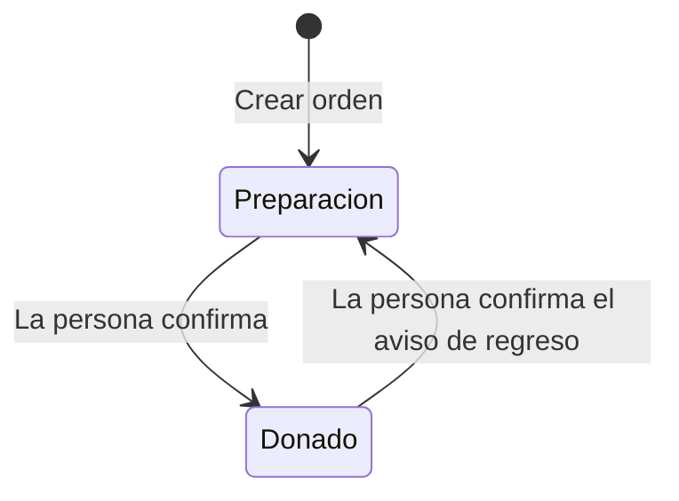

# Órdenes

## Alcance planteado

- Crear órdenes de donación con una fecha de entrega.
- Agregar equipos a una orden y gestionar el estado de cada equipo asociado.
- Indicar en el inventario cuándo un equipo pertenece a una orden y mostrar su fecha de entrega.
- En la tabla de órdenes, la búsqueda es por destinatario; la búsqueda por número de serie queda fuera del alcance por ahora.

## La orden y sus equipos

Una orden guarda el destinatario, que también es su título, una fecha de entrega obligatoria, una descripción opcional y su propio estado. Una orden puede existir sin equipos asociados.

| Tabla | Columnas |
| --- | --- |
| `orders` | `id`, `recipient`, `deliveryDate`, `description`, `status` |
| `notebooks` | `order_id`, opcional: vacío significa que el equipo no está asociado a ninguna orden |

Un equipo pertenece como mucho a una orden a la vez, y una orden puede tener varios equipos. El vínculo no conserva historial: al desvincular un equipo se limpia, y el equipo vuelve al Inventario con el estado que se elija.

### Los cambios se guardan en una sola operación

Editar una orden aplica en una sola operación los cambios de destinatario, fecha de entrega y descripción, junto con los equipos que se agregan y los que se quitan. Si la operación falla, no se persiste ninguno de los cambios y se conservan en el formulario para reintentar.

Lo mismo pasa al cambiar el estado de una orden: el estado de la orden y el de sus equipos cambian en la misma operación.

### Los estados de una orden

Una orden recorre dos estados, En Preparación y Donado, y el regreso a En Preparación pide confirmación.

Al pasar a Donado, sus equipos pasan a Donados; al volver a En Preparación, vuelven a Listo para donar. Mientras una orden está Donado, no se editan sus datos ni se agregan o quitan equipos. Una orden se elimina solo si no tiene equipos asociados y no está Donado.

## En el inventario

El formulario de un equipo que pertenece a una orden muestra, al final, el destinatario y la fecha de entrega de esa orden, con el destinatario enlazado al detalle de la orden. Mientras el equipo está asociado, su estado no se puede cambiar desde Inventario.
